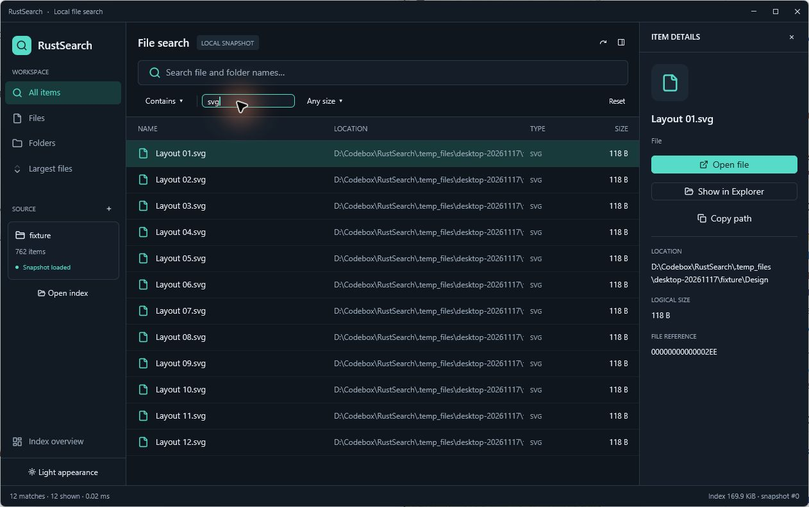

# RustSearch

A Windows file-search and disk-space analysis project focused on fast metadata queries and low resource use.

**Version: 0.0.1 — CLI prototype and GPUI desktop alpha.** Native NTFS/USN indexing, persistent snapshots, cached name queries, size filters, committed delta updates, and resource measurements are implemented. The Rust desktop app adds virtual results, keyboard navigation, file details, largest files, and dark/light appearances. The disk-space map is still planned.

The first release scope is file/folder search plus disk-space analysis. Content search comes later. All project documentation and user-facing text are in English.

## Download

The [0.0.1 Windows x64 release, build 2](https://github.com/ersinkoc/RustSearch/releases/tag/v0.0.1-build.2) includes the GUI, CLI, and a per-user PowerShell installer:

```powershell
Invoke-WebRequest https://github.com/ersinkoc/RustSearch/releases/latest/download/install.ps1 -OutFile install.ps1
powershell.exe -NoProfile -ExecutionPolicy Bypass -File .\install.ps1
```

Installation adds Start menu and Installed apps entries, preserves existing settings/indexes, and redirects enabled sign-in startup to a permanent location. Optional `-StartWithWindows` and `-DesktopShortcut` switches are available. See the [installation guide](docs/INSTALL.md) for updates, offline installation, uninstall, and runtime requirements. The ZIP also runs [portably](docs/PORTABLE.md). Binaries/scripts are unsigned; SHA-256 checksums and third-party notices accompany them.

Build 2 includes the notification/startup, saved-catalog, delta checkpoint and bounded reconciliation fixes. The original `v0.0.1` tag/archive remains available for historical reference; its executables cannot read newer checkpointed delta logs. The application version stays **0.0.1**.

## Current capabilities

- Native NTFS metadata enumeration on an explicitly selected local volume.
- Normal directory traversal for accessible folders without elevation.
- Substring, prefix, exact-name, extension, minimum-size, and largest-file queries.
- Persistent search tables and small delta overlays that preserve the base snapshot and cache.
- Full file references and original UTF-16 names, including unpaired surrogates.
- JSON reports for startup, warm queries, CPU, private commit, working set, and process I/O.
- A native GPUI interface that opens existing indexes or indexes accessible folders without elevation.
- A drive-selection screen, persistent computer catalogs, combined multi-drive queries, and per-drive coverage reporting.
- An embedded Windows application icon and file-type symbols for easier scanning of results.
- Automatic computer indexing, a per-user background worker, live delta updates, and optional sign-in startup.
- Native Windows window controls and a Settings page for worker lifecycle and indexing scope.



Native indexing stores one canonical name per file reference; additional hard-link names are not enumerated. Sizes remain unknown unless collected. `refresh` updates CLI-native snapshots; the desktop has a separate per-user background worker for managed sources. Queries do not search file contents. Allocated space, alternate streams, folder totals, and treemaps are not implemented.

Build 2 keeps its loaded index during queue recovery and includes the fixes verified in the C:/D:/E: follow-ups. See the [recovery and resource results](docs/OVERFLOW_RECOVERY_RESULTS.md), [runtime installation results](docs/RUNTIME_INSTALLATION_RESULTS.md), and [bounded reconciliation measurements](docs/BACKGROUND_CPU_RESULTS.md). Historical reports refer to the original archive, which has not been replaced.

If repeated scans persist, verify the executable actually running: a source build and an extracted portable release can own separate workers. The [runtime installation follow-up](docs/RUNTIME_INSTALLATION_RESULTS.md) records that mismatch, its local repair, and a further metadata/rename ordering fix.

## Build and try

Windows, Rust 1.93+ with the MSVC toolchain, and MSVC C++ build tools are required. Dependencies are pinned in `Cargo.lock`.

```powershell
cargo build --release --locked
New-Item -ItemType Directory -Path .temp_files -Force

# Normal user: scan an accessible folder.
.\target\release\rustsearch.exe index --root .\crates --sizes --output .temp_files\local.rsidx
.\target\release\rustsearch.exe search --index .temp_files\local.rsidx --ext rs

# Elevated PowerShell: enumerate the entire D: NTFS volume.
.\target\release\rustsearch.exe index --volume D: --output .temp_files\native.rsidx
.\target\release\rustsearch.exe refresh --index .temp_files\native.rsidx --sizes
```

Build and launch the desktop app separately:

```powershell
cargo build -p rustsearch-desktop --release --locked
.\target\release\rustsearch-desktop.exe
# Optional standalone snapshot view:
.\target\release\rustsearch-desktop.exe --index .temp_files\local.rsidx
```

A normal launch starts automatic accessible-drive indexing. Use **Settings** for pause, background, and Start with Windows controls, **This computer** to change selected drives, **Index a folder** for a smaller normal-user scan, or **Open index** for a snapshot/computer catalog. Accessible files works without elevation; Fast NTFS requires running the app as administrator. The managed worker keeps indexes current using filesystem notifications or native USN refresh where available. Explicitly opened snapshots remain read-only. See the [desktop guide](docs/DESKTOP.md) and [verification results](docs/DESKTOP_RESULTS.md).

## Performance evidence

The retained CLI benchmark corpus has 12.29 million records; the later [three-drive runtime checks](docs/RUNTIME_INSTALLATION_RESULTS.md) cover more than 22 million records. Each report separates correctness, startup, warm query time, and memory. These are measurements of this prototype, not evidence that it beats Everything.

The latest comparison reduced cached-search private memory from about 1,086 MB to 887 MB (18.3%), with working set also falling. Median CLI startup stayed close at 1.15 versus 1.13 seconds. Query-specific results and construction costs are included in the memory report.

- [Initial native disk feasibility](docs/PHASE_A_RESULTS.md)
- [Name grouping, shared arenas, and delta writes](docs/OPTIMIZATION_RESULTS.md)
- [Persistent search cache](docs/CACHE_RESULTS.md)
- [Single-pass snapshot/cache loading](docs/LOAD_RESULTS.md)
- [Sequential cache membership validation](docs/CACHE_VALIDATION_RESULTS.md)
- [Compact in-memory metadata and names](docs/MEMORY_RESULTS.md)
- [Common ASCII substring scan without additional index memory](docs/COMMON_SUBSTRING_RESULTS.md)

Earlier 0.2/0.3/0.4 labels in historical reports identify unpublished experiment binaries. The project version remains **0.0.1**. Raw disk snapshots and local metadata evidence are excluded from this public repository.

The common one-character substring follow-up reduced the `a` query from 12.04 to 6.01 ms on the same corpus, with unchanged source/search-table allocations. With two deltas it improved from 12.17 to 6.88 ms; see the common-substring report for all query groups and memory counters.

The [background CPU follow-up](docs/BACKGROUND_CPU_RESULTS.md) measures bounded live-folder reconciliation on the same three-drive source.

## Project documentation

- [CLI commands and limitations](docs/CLI.md)
- [Install, update, and uninstall](docs/INSTALL.md)
- [Desktop app and shortcuts](docs/DESKTOP.md)
- [Desktop visual and correctness checks](docs/DESKTOP_RESULTS.md)
- [Full-drive search and original monitoring failure](docs/FULL_DRIVE_ACCEPTANCE.md)
- [Notification overflow recovery and full-drive live-update results](docs/OVERFLOW_RECOVERY_RESULTS.md)
- [Product and technical plan](docs/PROJECT_PLAN.md)
- [Everything baseline and feature gaps](docs/FEATURE_BASELINE.md)
- [Benchmark protocol and engineering targets](docs/BENCHMARKS.md)

Everything already provides fast metadata indexes and optional folder-size indexing. Rust or NTFS enumeration alone does not establish an advantage. A competitive claim requires the same hardware, indexed scope, query semantics, freshness, and ordering, with recorded competitor versions and settings.

Reference material consulted during the initial research on 16 November 2026: [Everything indexes](https://www.voidtools.com/support/everything/indexes/), [Microsoft NTFS enumeration](https://learn.microsoft.com/en-us/windows/win32/api/winioctl/ni-winioctl-fsctl_enum_usn_data), and [USN change journals](https://learn.microsoft.com/en-us/windows/win32/fileio/change-journals). This project is not affiliated with Everything or voidtools.
