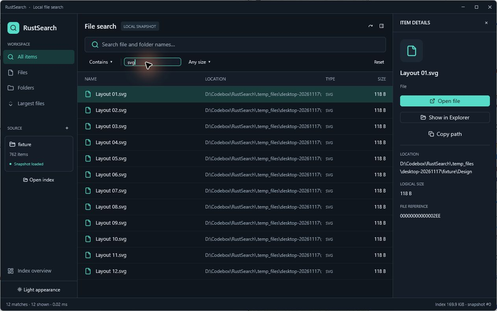
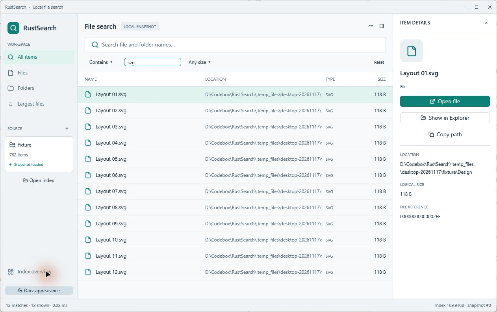

# RustSearch desktop

The Windows **0.0.1** desktop alpha uses Rust and GPUI. It shares the CLI's snapshot, delta, cache, and query implementation. No browser or WebView is used for its interface.



## Build and start

Use Windows 11 x64, Rust 1.93+ MSVC, and the MSVC C++ build tools. The compatible GPUI 0.2.2 and gpui-component 0.5.1 releases are pinned; build with the committed lockfile.

```powershell
cargo build -p rustsearch-desktop --release --locked
.\target\release\rustsearch-desktop.exe
.\target\release\rustsearch-desktop.exe --index .temp_files\local.rsidx
.\target\release\rustsearch-desktop.exe --no-restore --light --compact
```

By default, the app restores the last successfully opened index and appearance. `--no-restore` starts without an index; `--index PATH` selects one explicitly. These arguments are processed in order. `--light` selects light appearance. `--compact` starts at 960 × 600 instead of 1260 × 790 logical pixels. Settings and GUI-created folder indexes are stored under `%LOCALAPPDATA%\RustSearch`.

Choose **Index a folder** to scan accessible metadata and logical file sizes without elevation. Reparse targets are not followed. The app saves a private snapshot and prepares its search tables. Cancellation is cooperative: it stops traversal at an entry boundary; an operation already inside snapshot writing or cache preparation must finish that phase before the worker can stop. Source files are never changed by indexing.

Choose **Open index** for a `.rsidx` snapshot or a `.rscatalog` computer catalog. Keep each snapshot's matching `.delta` alongside it. The reload icon opens the latest committed views and rebinds their immutable base search caches. It does not watch the filesystem, run `refresh`, or elevate the process. CLI-native snapshots remain compatible.

## Index this computer

Open **This computer**, or choose **Index this computer** on the welcome screen. Ready local fixed drives are selected initially; removable drives can be included explicitly. Each drive shows its filesystem, type, free space, and total capacity. Refresh drives after connecting media. These capacity bars describe Windows volume space, not indexed folder totals.

- **Accessible files** scans selected drives without administrator access. Protected entries may be skipped and the scan can take considerably longer than NTFS enumeration.
- **Fast NTFS** uses native metadata enumeration on NTFS drives. Run the executable as administrator yourself when using this mode. It requires an existing USN journal, never creates one, and reports failed drives instead of silently changing the scan method. File actions inherit that process's permissions.
- **Collect logical file sizes** enables size queries and Largest files. Disable it for a faster name index. Native size collection can be expensive on large volumes; unknown sizes are never treated as zero.

The scan processes drives sequentially and publishes a separate private snapshot for each successful drive. A private `computer.rscatalog` under `%LOCALAPPDATA%\RustSearch\computer-*` records the snapshot paths and failed-drive messages. It restores as one searchable source on the next launch. The original full file ID is scoped by its source index; identical IDs on two drives remain separate results.

**All locations** searches every loaded source; its menu narrows results to one drive. Normal results are ordered by catalog source, then full ID. Largest files combines known sizes across drives, descending, with source and ID as tie breakers. Counts include every matching source, while only the requested rows are hydrated. Failed sources and skipped entries appear in a persistent partial-coverage banner; **Review coverage** opens per-location details. Cancellation leaves completed private snapshots on disk but does not publish an unfinished catalog.

This flow covers assigned local fixed/removable drive letters. Network/optical drives, volumes mounted only as folders, unmounted or locked volumes, and reparse targets are excluded. It does not guarantee access to every protected file. Add a reachable folder separately where appropriate. Existing snapshots are point-in-time observations; reconnecting or rescanning is explicit.

## Application identity

The executable embeds a seven-size Windows icon (16–256 pixels), English product metadata, and version **0.0.1**. The SVG source is used in the sidebar; generic file-type symbols distinguish source code, documents, images, media, and archives without loading Shell extensions for every result. The icon is bundled into the executable, so it does not depend on a neighboring image file.

To regenerate the ICO from the deterministic vector geometry:

```powershell
New-Item -ItemType Directory -Path .temp_files -Force
rustc scripts/generate-icon.rs -O -o .temp_files\generate-icon.exe
.\.temp_files\generate-icon.exe
```

## Search and file actions

The search field matches names. Contains, Starts with, and Exact name modes combine with extension, file/folder, and minimum logical-size filters. **Largest files** sorts known sizes descending; unknown sizes are excluded. Zero length remains distinct from unknown. **Reset** clears filters and returns to All items while retaining the search text; the search field's clear button clears its text.

The list counts every match and initially returns up to 500 rows. **Show 500 more results** raises the limit in steps, up to 10,000. Only visible rows are rendered. The details pane shows location, logical size, and full file reference. It can be hidden and is automatically omitted below 1080 logical pixels wide.

Double-click or use **Open file/folder** to open the selected item. **Show in Explorer** reveals it. File actions retain the original UTF-16 path; the displayed path hides ordinary internal extended-path prefixes. Copy path uses ordinary Unicode text and reports an error for unpaired UTF-16 instead of silently changing a filename. An indexed item may have moved since the snapshot; reload a refreshed index when necessary.

| Shortcut | Action |
| --- | --- |
| Ctrl+F / Ctrl+L | Focus search |
| Ctrl+O | Open an index |
| Ctrl+Shift+O | Index a folder |
| Ctrl+J / Ctrl+K | Select next/previous result and focus the list |
| F6 | Focus the result list |
| Up / Down, with the list focused | Select previous/next result |
| Enter | Open selected item |
| Ctrl+Enter, with the list focused | Reveal selected item |
| Ctrl+Shift+C | Copy selected path |
| Escape | Clear search |
| Ctrl+Shift+T | Toggle dark/light appearance |



## Resource behavior and limits

One background thread owns each loaded source and borrowing search index once. During a computer scan, it drops each drive's scan data before scanning the next; it then loads the published sources and search tables together. RAM scales with the sum of loaded indexes. Query merging retains at most twice the requested ID limit before truncation, and at most 10,000 hydrated rows. The UI receives immutable statistics and bounded rows, without copying millions of records. One replaceable pending request coalesces rapid input, stale generations are ignored, and one pending reply bounds the return queue. Paths are reconstructed on the worker. The worker sleeps on a condition variable when idle; UI updates are event-driven.

The footer's query time measures query execution and merging only. It excludes path hydration, delivery, painting, and source/cache loading. **Index memory** reports allocated source and search-table storage, not total process private memory or GPU memory. The overview shows size coverage among indexed files, per-location generations and skips, pending refresh count, failed drives, and source/cache preparation times.

This is a desktop alpha. Folder totals, treemaps, allocated/reclaimable space, path/date/content search, a query parser, tray/global activation, continuous refresh, installers, and updates are not implemented. Screen-reader support, mixed-DPI/multi-monitor behavior, and long-duration UI resource budgets still need acceptance testing. See [verification results](DESKTOP_RESULTS.md).
