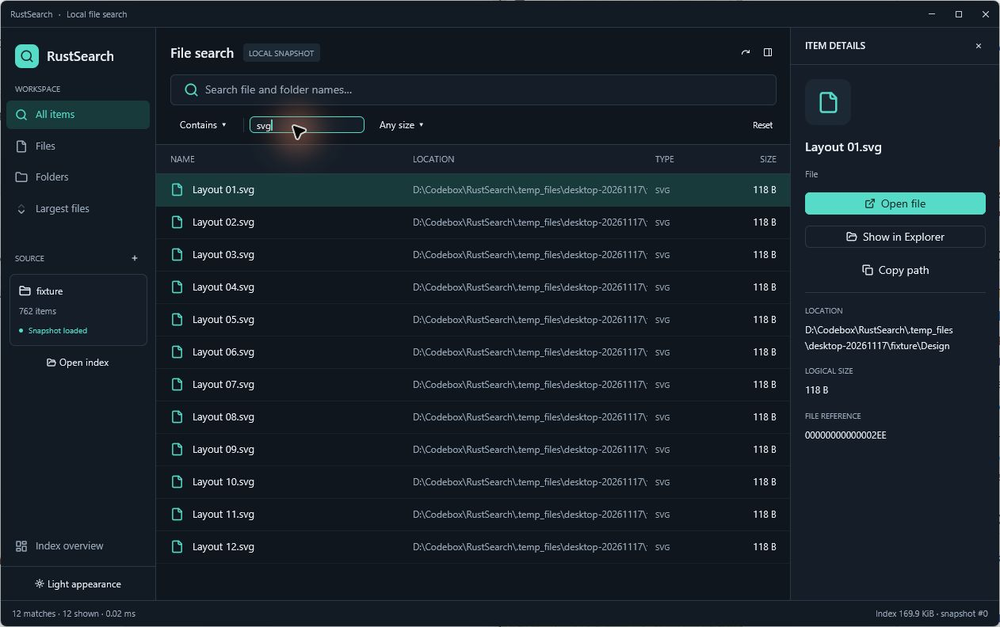
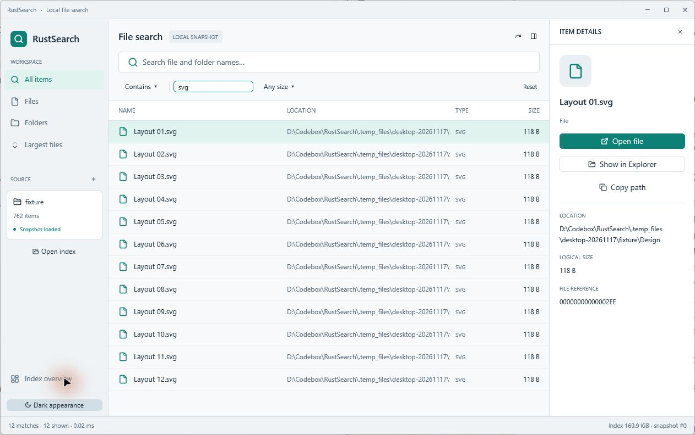
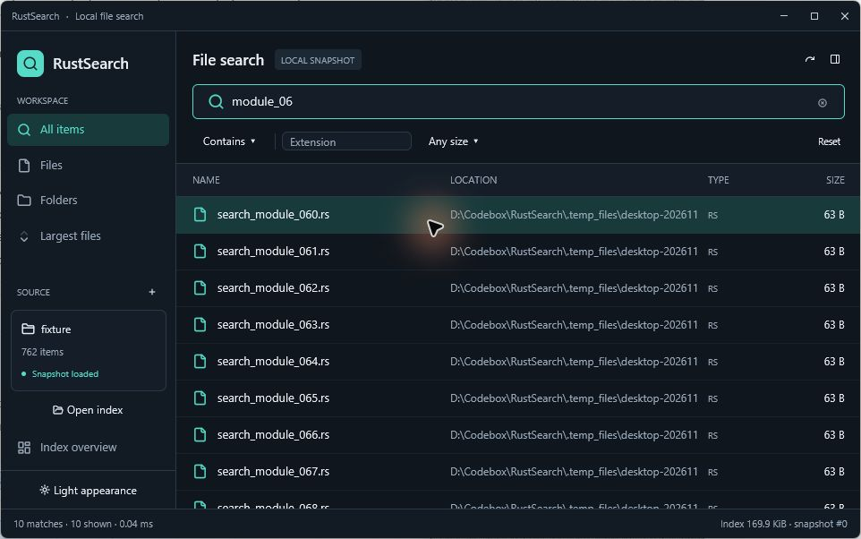
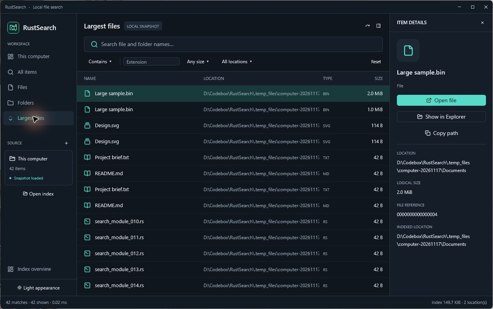
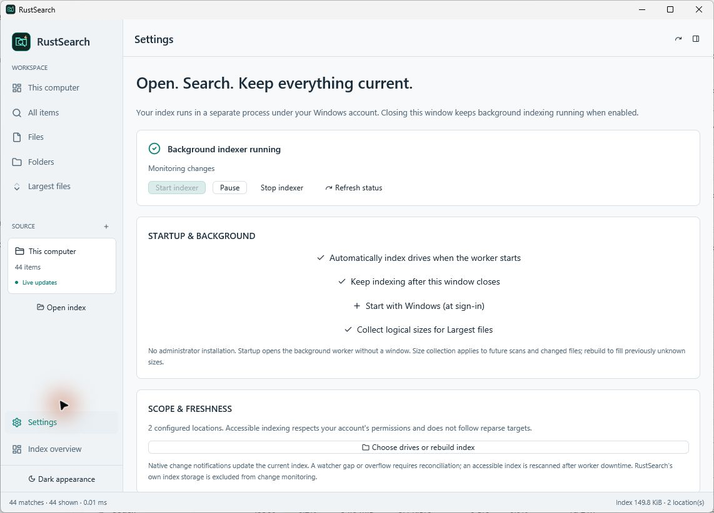

# Desktop alpha verification

Verified on 17 November 2026 on Windows 11 x64 with the MSVC Rust toolchain. All workspace packages remain **0.0.1**. This is local desktop acceptance; it is not an installer release or an Everything performance comparison.

## Corrections during visual review

- Gave the virtual list and rows their full available width, keeping Name, Location, Type, and Size aligned and selection backgrounds consistent.
- Simplified ordinary extended drive and UNC prefixes for display while preserving original UTF-16 paths for file actions. Device/volume namespaces retain their meaning.
- Used the source folder name in the sidebar and made the name-search scope explicit in the placeholder.
- Cleared stale operation notices when beginning another folder scan.
- Resolved strict Clippy findings without suppressing lint rules.

## Observed desktop behavior

The generated, disposable folder on D: contains 762 indexed entries: 758 files and four folders. It includes 620 Rust files, twelve SVG files, 120 planning notes, Unicode names, a zero-length file, and a 3 MiB file. Screenshots show only this generated fixture. Raw real-disk indexes and private result lists are not published.

| Check | Observed result |
| --- | --- |
| Open a CLI-generated snapshot | 762 matches; first 500 hydrated rows |
| Contains `module_06` | Ten matches, `search_module_060.rs` through `069.rs` |
| Starts with `module_06` | Zero matches and a readable empty state |
| Reset filters from the empty state | Ten substring matches restored; text retained |
| Ctrl+J, then Down | Selection and inspector moved to rows 061 and 062 |
| Extension `svg` | Twelve matching SVG rows |
| Largest files | 758 known-size files, descending size; 3 MiB file first |
| Minimum size 1 MiB | Only the 3 MiB file |
| Show 500 more | All 762 fixture rows available; expansion button removed |
| Scroll the list | New rows render within the same fixed viewport |
| Copy path | Visible success notice |
| Index overview | 762 total, 758 files, four folders, 100% indexed-file size coverage, generation zero |
| Dark/light switch | Both appearances preserve readable text, selected rows, menus, inputs, and details |
| Native folder picker and scan | Fixture scanned and saved under the local application data directory; 762 entries and twelve retained SVG matches |
| Compact window, 960 × 600 logical pixels | Ten `module_06` matches in both appearances; aligned columns and visible footer; inspector automatically hidden |







## Automated validation

```powershell
cargo fmt --all --check
cargo clippy --workspace --all-targets --release --locked -- -D warnings
cargo test --workspace --release --locked
cargo build --workspace --release --bins --examples --locked
```

The initial desktop suite passed **45 tests**, with zero failures, ignored tests, or filtered tests. The desktop library contributed three tests: source-error recovery/latest-query delivery, two persisted delta generations with an unchanged base cache, and Unicode/namespace path presentation. The Windows indexer added a controlled-walk cancellation check that leaves source files unchanged. Existing query, cache, snapshot, delta, UTF-16, zero/unknown-size, junction-cycle, and CLI integration checks also passed.

The worker's delta test loads the base, commits a rename/resize plus deletion/insertion, reloads generation one, then commits a file-to-folder change and deletion and reloads generation two. Returned IDs, names, kinds, sequence, and cache-hit state are asserted; base cache bytes remain identical. This is a deterministic persisted fixture test, separate from the previous real-NTFS acceptance reports.

## Limits of this verification

The desktop stderr capture was empty during the fixture session. Screen-reader support, multiple monitors, mixed DPI, remote/removable paths, long-duration memory/CPU behavior, and GUI-inclusive latency distributions were not accepted by this run. The previous approximately 887 MB CLI measurement is not a total desktop/GPU memory measurement. Footer query timings exclude path hydration and rendering and must not be presented as input-to-visible latency.

Folder maps and incremental folder totals remain planned. See the [desktop guide](DESKTOP.md) for supported behavior and the [benchmark protocol](BENCHMARKS.md) for future performance acceptance.

## Multi-drive and application-icon follow-up

The follow-up extends the suite to **49 passing tests**. New checks cover colliding file IDs across two sources, combined counts and largest-file ordering, per-location filtering, cache-hit catalog reload, two scanned folders plus an unavailable root, catalog version/path/duplicate rejection, and native cancellation before volume access. The original persisted-delta tests continue to pass.

The PE resource directory contains icon images, an icon group, and English version information. The embedded ICO includes seven sizes from 16 to 256 pixels. Windows reports product name RustSearch and file/product version 0.0.1. The application mark's source SVG and deterministic ICO generator are committed.

The unprivileged drive-selection screen detected C:, D:, E:, and removable F: with filesystem and capacity data. Native D: probing correctly returned Access denied in this session; administrator-mode full-drive scanning was not run. A full-machine accessible-file scan was not started during UI acceptance. Two generated 21-file sources exercise the actual combined GUI instead: all locations returns 42 files, and selecting Documents returns 21, including its 2 MiB file. Private drive labels and raw disk data are not included in published screenshots.

Visual review found a blank application mark because GPUI's string conversion interpreted the asset name as a URI. The fix selects an embedded resource explicitly. A persistent indexing action in the toolbar also keeps the scan button reachable while scrolling through drives and options.

The corrected mark rendered in the rebuilt application. The toolbar's drive count updated for every selection change and disabled indexing at zero selected drives. Combined Largest files showed the 2 MiB Documents file before the 1 MiB Projects file.

An independent normal-user directory scan of the small FAT F: volume matched `Get-ChildItem -Recurse -Force`: four records, three files, one folder, zero skipped entries, and all three file sizes known. This checks the same traversal backend used by Accessible files, separately from GUI acceptance. It does not establish coverage of C:, D:, or E: or an administrator-mode native scan.



## Background worker and native-frame acceptance

The Windows release follow-up passes **56 tests** with zero failures, ignored tests, or filtered tests. The full workspace release test suite, strict release Clippy, formatting check, and release binaries/examples build pass on the release sources. New coverage includes authenticated bounded worker IPC, Windows accepted-socket blocking mode, updates with a disconnected GUI client, pause/resume, isolated current-user startup registration, safe generation retention, original Unicode directory moves, and search-table reuse across deltas.

A deterministic regression first reproduced notification-queue overflow after 10,000 repeated metadata writes to one path. Coalescing now rereads that path once between structural-event barriers. Rename ordering and actual notification-loss recovery remain intact. This does not eliminate genuine overflow during heavy filesystem churn.

Direct Windows acceptance on the rebuilt native-frame binary verified:

| Action | Observed result |
| --- | --- |
| Alt+Space with the search input focused | Native system menu opened, with Move, Size, Minimize, Maximize, and Close |
| Maximize and Restore | Native accessibility state changed to Restore, then back to Maximize |
| Minimize and reactivate | Windows reported a minimized window; reactivation restored it |
| Mouse resize from the left edge | Width changed from 1262 to 1142 captured pixels, with the opposite edge fixed |
| Caption drag | Window origin moved by the requested 80 × 50 pixels without resizing |
| Alt+F4 and caption Close | GUI exited; the independent worker remained running |
| Compact live results | 44 fixture records at 960 × 600 logical client size; inspector hidden and footer visible |
| Settings Pause and Resume | Running/paused status and source freshness labels changed; settings persisted |

The old GPUI caption was replaced with the native frame. A small HWND subclass keeps non-client mouse handling and Alt+Space/Alt+F4 in Windows' default procedure; ordinary client input and GPUI window lifecycle messages retain the framework handler. Without that routing, the framework could consume native resize clicks and the system-menu shortcut.

The worker acceptance used two generated folders outside the index-storage directory. After the GUI closed, a new file produced a durable delta, one matching search row, and 44 combined records. The same worker process survived reconnect. SHA-256 comparisons confirmed that both base snapshots and persistent search caches stayed byte-identical. An earlier fixture placed under the excluded storage root was corrected before making this claim. No private disk filenames are published.

The actual C:/D:/E: worker was restarted with its saved size-collection and sign-in-startup preferences. Its status showed active scanning. This is not acceptance of complete machine coverage or long-duration freshness: accessible scans can be slow and genuine notification loss can trigger reconciliation. Native volume access, Windows sign-in/reboot, clean-machine startup, mixed DPI, and screen-reader acceptance were not added by this run.



## Full-drive follow-up

The subsequent [full-drive acceptance report](FULL_DRIVE_ACCEPTANCE.md) found repeated notification-overflow reconciliation on the approximately 21.86-million-record C:/D:/E: scope. Published snapshot searches passed, but full-drive live monitoring and an idle resource budget did not pass acceptance. The small-fixture checks above must not be treated as full-machine acceptance.

## Open upstream dependency alert

GitHub reports [GHSA-38c5-483c-4qqp](https://github.com/becheran/grid/security/advisories/GHSA-38c5-483c-4qqp), a moderate integer-overflow advisory in `grid::Grid::expand_rows`. The desktop dependency chain is GPUI 0.2.2 → pinned Taffy 0.9.0 → grid 0.18.0. The advisory's patched version is grid 1.0.1, outside Taffy's current requirement; replacing it is not a compatible lockfile-only update. No `expand_rows` call was found in the installed Taffy 0.9.0 source, but the dependency alert remains open. This source inspection is not a full security audit. The CLI's default dependency graph does not include this GUI layout stack.
