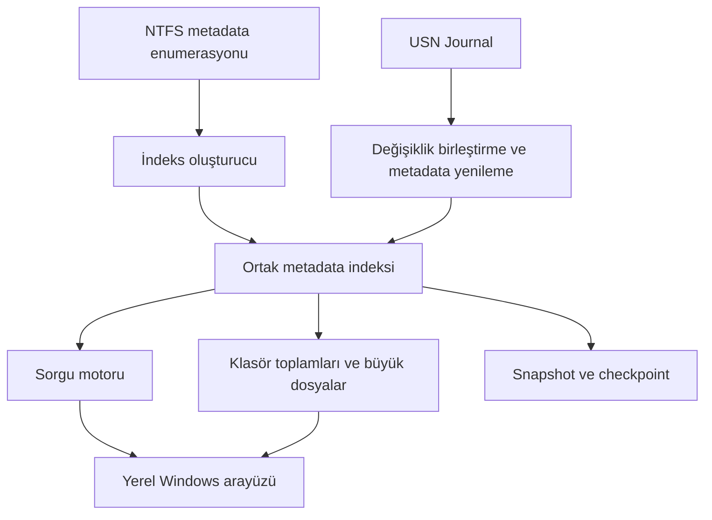

# RustSearch — Ürün ve teknik plan

Tarih: 16 Kasım 2026. Çalışma adı: RustSearch. Durum: A aşaması CLI prototipi uygulandı ve gerçek NTFS diskinde denendi; [sonuçlar](PHASE_A_RESULTS.md), güncel kullanım ve kapsam [CLI.md](CLI.md) içinde. Bu belge hedef mimariyi ve sonraki aşamaları tanımlar.

## 1. Ürün tanımı

Windows üzerinde dosya bulmayı ve disk alanını anlamayı aynı güncel indeksle sağlayan masaüstü uygulaması. Öncelik sırası: doğru sonuç, düşük kaynak tüketimi, algılanan hız ve arayüz sadeliği.

Kullanıcı kararı: İlk sürüm dosya/klasör adı, yol, uzantı, boyut ve tarih araması ile disk alanı haritasını kapsar. İçerik araması sonraki aşamadır.

“Her şeyi bulmak”, ilk sürümde desteklenen ve indekse alınmış disklerdeki mevcut dosya ve klasör metadata'sını bulmak demektir. Silinmiş dosya kurtarma, kilitli BitLocker birimleri, arşiv içi dosyalar, çevrimdışı bulut içeriği ve sanal dosya sistemlerinin içeriği bu kapsama girmez. VHDX, WSL ve arşiv dosyaları dış dosya olarak görünür; içleri açılmaz.

İlk hedef Windows 11 x64 ve yerel NTFS SSD/HDD. Windows 10, ARM64, ReFS, FAT/exFAT, NAS ve ağ paylaşımları ayrı uyumluluk aşamasında ele alınır. Farklı dosya sistemlerine aynı hız sözü verilmez.

## 2. Kullanıcı deneyimi

### Arama

- Kısayolla açılan pencere; yazarken iptal edilebilir arama.
- Dosya adı, tam yol, uzantı, tür, disk, boyut ve değiştirilme tarihi filtreleri.
- Dosyalar/klasörler, gizli/sistem öğeleri ve büyük dosyalar için görünür filtreler.
- Sanal sonuç listesi; milyonlarca sonucu arayüz nesnesine dönüştürmeme.
- Normal kullanıcı yetkisiyle açma, bulunduğu klasörü gösterme ve yol kopyalama.
- Klavye ile gezinme; yüksek DPI, Türkçe ve İngilizce arayüz.
- Sıralama ve tam sonuç sayısının ilk sonuçtan ayrı tamamlanabilmesi.

Örnek hedef sözdizimi; Everything ile tam sözdizimi uyumluluğu vaat edilmez:

```text
invoice                         # ad içinde arama
ext:pdf                         # uzantı filtresi
size:>1GiB                      # dosya boyutu filtresi
path:"D:\Projects" ext:rs       # yol + uzantı
type:folder                     # klasör sonuçları
modified:>=2026-11-01            # tarih filtresi
```

Tırnaklı ifade, AND, OR ve dışlama anlamları parser sözleşmesinde tanımlanır. Hatalı sorgu sessizce farklı anlama çevrilmez. Varsayılan ad araması büyük/küçük harfe duyarsızdır; Windows dosya adı karşılaştırması ile Türkçe i/İ/ı/I beklentileri için açık testler gerekir. Kayıplı UTF-8 dönüşümü dosya kimliğini belirlemez; özgün UTF-16 ad korunur.

### Disk alanı

- Disk → klasör → alt klasör gezinmesi; aynı seçim ağaç, dosya listesi ve haritada korunur.
- Klasör toplamı, alt öğe sayısı, yüzde ve boyuta göre sıralama.
- Treemap: alanı boyutla orantılı dikdörtgenlerle gösteren disk haritası.
- En büyük dosyalar, en büyük klasörler ve uzantıya göre dağılım.
- Mantıksal boyut / diskte kaplanan alan arasında açık seçim.
- İndeksin kapsadığı alan, erişilemeyen alan ve güncellik durumu görünür.
- Harita açılınca ikinci bir tam disk taraması yapılmaz; eksik boyut bilgisi arka planda tamamlanır ve kısmi sonuç açıkça işaretlenir.

### İlk sürüm dışı

Belge/kod içeriği, OCR, anlamsal/AI arama, sürekli hash hesaplama, kopya dosya taraması, otomatik temizlik, Explorer yerine geçme ve uzaktan arama ilk sürüme alınmaz. İlk sürüm disk analizinde salt okunurdur; silme ve taşıma ayrı ürün kararıdır.

## 3. Rekabet ve başarı ölçütü

Everything'in resmî belgeleri gerçek zamanlı metadata indekslerini, isteğe bağlı klasör boyutlarını ve hızlı sıralama indekslerini açıklıyor. Bu özellikler tek başına farklılaşma değildir. [Kaynak](https://www.voidtools.com/support/everything/indexes/)

Farklılaşma hipotezleri:

1. Ortak indeksle arama sonucundan klasörün alan haritasına hızlı geçiş.
2. Sıkıştırılmış metadata ve ihtiyaca göre ek indekslerle düşük bellek tüketimi.
3. Büyük sonuç kümelerinde ilk görünür sonuç ve boyut sıralamasında düşük gecikme.
4. Açık güncellik ve kapsam bilgisiyle güvenilir disk analizi.

Hız hedefi, karşılaştırılabilir büyük indeks sorgularında p95 gecikmeyi en az 2 kat iyileştirmektir; garanti değildir. Kazanç yalnız belirli sorgu sınıflarında varsa iddia o sınıflarla sınırlandırılır. Gecikmeyi iyileştirirken RAM/CPU/I/O artıyorsa sonuç birlikte değerlendirilir.

## 4. Teknik kararlar

| Alan | Başlangıç kararı | Gerekçe / doğrulama |
| --- | --- | --- |
| Çekirdek | Rust, stable MSVC toolchain | Veri yerleşimi ve Windows API kontrolü; sürüm uygulamaya başlarken sabitlenir |
| Windows erişimi | Resmî windows/windows-sys bağlayıcılarından uygun olanı | FFI sınırını dar tut; kullanılan API'leri özellik bazında aç |
| Arayüz | Win32 sanal ListView + Direct2D harita adayı | Windows odaklı düşük kaynak hedefi; kullanılabilirlik ve bellek prototipiyle kesinleşir |
| İndeks | Sürüme sahip paketli snapshot + sınırlı değişiklik katmanı | Her kayıtta nesne/ayrı tahsis ve yinelenen tam yol maliyetinden kaçın |
| Güncelleme | NTFS USN Journal + hedefli metadata yenileme | Boşta periyodik tam taramadan kaçın |
| Ayarlar | Küçük yerel yapılandırma dosyası | Ana sorgu yoluna genel amaçlı DB zorunluluğu koyma |
| Kalıcılık | Atomik snapshot yayımı + dayanıklı checkpoint | Çökme sonrası doğrulanmış nesilden devam et |

Alternatif GUI çatıları yalnız yerel arayüz prototipi süre/maliyet açısından başarısızsa aynı bellek ve erişilebilirlik ölçütleriyle değerlendirilir. Rust tek başına düşük RAM garantisi değildir.

### Bileşenler



Normal kullanıcı süreci çekirdek indeksin tek sahibidir; arayüz bunu kullanır. Ayrı UI/arama süreçlerinde indeks kopyaları oluşturulmaz. Pencere kapandığında render ve ikon/önizleme işleri durur; güncelleme çekirdeği tepside kalabilir.

Ham birim erişimi gereken bölüm dar bir ayrıcalıklı yardımcıdır. Prototipte kullanıcı tarafından başlatılan yükseltilmiş yardımcı kullanılır. Kurulabilir servise geçiş, otomatik başlangıç ve kullanıcı oturumu yaşam döngüsü denendikten sonra kararlaştırılır. Dosya açma ve Shell eylemleri yükseltilmiş yardımcıda yapılmaz.

## 5. NTFS indeksleme ve doğruluk

### İlk indeks

1. Birimi sürücü harfiyle değil kalıcı birim kimliğiyle tanı; NTFS desteğini kontrol et.
2. Journal kimliğini ve başlangıç USN sınırını kaydet; başlangıç taraması boyunca olayları kaybetmeyecek şekilde biriktir.
3. `FSCTL_ENUM_USN_DATA` ile ad/ebeveyn/dosya kimliği tabanını oluştur. Bu API sonucu ham MFT bayt dökümü değildir. [Microsoft](https://learn.microsoft.com/en-us/windows/win32/api/winioctl/ni-winioctl-fsctl_enum_usn_data)
4. Boyut ve diğer eksik alanlar için sınırlandırılmış metadata toplama yap. İsim indeksi hazır olunca aramayı aç; boyut kapsamını ayrıca bildir.
5. Tarama süresindeki olayları yeniden uygula; dosya kimliği ve güncellik kontrolleriyle eski tarama verisinin yeni olayı ezmesini önle.
6. Başlangıç sınırının journal içinde kaldığını yeniden doğrula; tam kapsamı ancak uzlaşma tamamlanınca bildir.

`USN_RECORD_V2` ad, kimlik, ebeveyn ve değişiklik nedenini taşır; dosya uzunluğu/ayrılmış alan alanlarını içermez. Boyut için yalnız USN enumerasyonuna güvenilemez. [Microsoft yapı tanımı](https://learn.microsoft.com/en-us/windows/win32/api/winioctl/ns-winioctl-usn_record_v2)

Boyut toplama adayları: sınırlı dosya kimliği/handle sorguları ve gelişmiş toplu NTFS metadata okuma. Her dosyada seri handle açmak darboğaz oluşturabilir. Ham MFT ayrıştırması varsayılan ilk çözüm değildir; ihtiyaç ölçülürse ayrı prototipte fixup, attribute-list, ek kayıt ve bozuk kayıt sınırlarıyla değerlendirilir. Toplu API'lerin alan kapsamı ve sürüm desteği kodlama aşamasında doğrulanır.

### Sürekli güncelleme

- Journal olaylarını dosya kimliği bazında birleştir; veri değişiminde boyutu yeniden sorgula.
- Yoğun yazılan dosyalarda kapanış olayını bekleyen tek strateji kullanma; sonlu gecikmeli örnekleme uygula ve son güncelleme zamanını göster.
- Rename/move/delete, hard-link değişimi, kayıp parent ve MFT kayıt numarası yeniden kullanımını işle.
- Kimlik, birim + tam dosya referansı/sequence bilgisini korur; yalnız MFT sıra numarası değildir.
- Yinelenen olaylar toplamları iki kez değiştirmemeli. Checkpoint ancak ilişkili indeks güncellemesi dayanıklı olduğunda ilerler.
- Journal sarılması, silinmesi veya kimlik değişimi fark edilince indeks güncel sayılmaz; ilgili birimi yeniden uzlaştır veya yeniden kur.
- Disk çıkarılması, uyku/uyanma ve servis kesintisi sonrası journal aralığını yeniden doğrula.

Microsoft değişiklik günlüğünü, tam birim taramasına alternatif ve indeks kurtarma mekanizması olarak tanımlar. [Kaynak](https://learn.microsoft.com/en-us/windows/win32/fileio/change-journals)

## 6. Ortak veri modeli ve arama

Temel model: `Volume → FileObject → DirectoryEntry`. Hard link nedeniyle bir dosya nesnesinin birden çok adı/ebeveyni olabilir. Arama ad girdilerini döndürür, fiziksel alan hesabı dosya nesnesini kullanır. Enumerasyonun bütün bağlantı adlarını sağladığı varsayılmaz; hard-link keşfi ve USN ile uzlaştırması doğruluk prototipinin parçasıdır.

- Paketli sabit metadata kolonları; adlar ayrı havuzda, kayıtlar offset ile erişilir.
- Tam yol her kayıtta yinelenmez; ebeveyn bağlantılarından gerektiğinde oluşturulur ve küçük cache ile tutulur.
- Özgün UTF-16 ad ile arama anahtarı ayrıdır. Arama anahtarının ek bellek maliyeti bütçeye girer.
- Başlangıç stratejisi: kompakt doğrusal ad taraması + uzantı/boyut filtreleri. Prefix ve substring farklı iş yükleridir.
- Profil sonucuna göre sıralı prefix indeksi veya seçici n-gram eklenir; bütün adlara koşulsuz ağır trigram indeksi kurulmaz.
- İlk 100 sonuç için top-k; tam sıralama ve sonuç sayısı gerektiğinde ayrı hesaplanır. Sonuçların eksik/geçici olması görünürdür.
- Art arda yazılan daraltıcı sorgular önceki aday kümesini kullanabilir; sorgu genişleyince tam aday kaynağına döner.
- Eski sorgular nesil numarasıyla iptal edilir. Her UI isteği tutarlı bir indeks nesline bağlıdır.
- Snapshot ve değişiklik katmanı yinelenen/silinmiş sonuçları uzlaştırır; büyüyen delta kontrollü birleştirilir.
- Memory mapping yalnız bir adaydır; fiziksel bellek/cache maliyetini yok etmez.

## 7. Klasör boyutlarının doğru anlamı

| Ölçü | Üründeki anlamı |
| --- | --- |
| Mantıksal boyut | Dosyanın görünen veri uzunluğu |
| Diskte kaplanan alan | Doğrulanmış allocation/compression bilgisine göre alan; tek dosyayı silince kazanılacak alan değildir |
| Klasör mantıksal toplamı | Altındaki ad girdilerinin mantıksal toplamı; hard linklerin tekrarı açıkça belirtilir |
| Tekilleştirilmiş alan | Dosya nesnesi bir kez sayılır; birimler arası kimlikler karıştırılmaz |
| Bilinmeyen alan | Boyutu toplanmamış veya kapsam dışı öğeler; sıfır kabul edilmez |

İlk oluşturma ağaç üzerinde aşağıdan yukarı toplama yapar. Tek dosya boyutu değişimi ilgili atalarda delta uygular. Büyük klasör taşınması alt ağacı tekrar taramak yerine mevcut alt ağaç toplamını eski/yeni ata zincirlerine taşır; eşzamanlı işlemler tutarlı nesilde uygulanır.

Hard linklerin alan haritasında tek bir deterministik sahip ad girdisine atanması önerilir; diğer bağlantılar işaretlenir. Böylece ana haritanın toplamı çifte sayılmaz. Seçili klasörün erişebildiği bütün bağlantıların tekilleştirilmiş toplamı farklı bir ölçüdür; bu iki ölçü karıştırılmaz. Son hard link silinmeden alanın serbest kalacağı iddia edilmez. [Microsoft hard links](https://learn.microsoft.com/en-us/windows/win32/fileio/hard-links-and-junctions)

Sparse/sıkıştırılmış dosyalar, resident veri, alternatif veri akışları, bulut placeholder'ları ve ayrılmış alan için ayrı doğruluk örnekleri gerekir. Default veri akışı boyutu, bütün akışların toplamı diye sunulmaz. Sparse alanın görünen uzunluktan farklı olabildiği resmî olarak belgelenmiştir. [Microsoft sparse boyutları](https://learn.microsoft.com/en-us/windows/win32/fileio/obtaining-the-size-of-a-sparse-file)

Junction/symlink hedefleri varsayılan olarak takip edilmez. MFT/sistem metadata'sı, shadow copy, ayrılmış kümeler ve erişilemeyen nesneler nedeniyle dosya toplamı Windows'un kullanılan disk alanıyla birebir aynı olmayabilir. Haritada açıklanamayan fark ayrı gösterilir; farkın tamamına kesin bir sebep atanmaz. Bulut dosyalarının içeriği boyut öğrenmek için indirilmez.

## 8. Kaynak yönetimi ve yetkiler

- Boşta tam disk taraması ve sabit aralıklı UI yenilemesi yok; journal bekleme ve olayla uyanma.
- HDD için düşük paralellik; SSD için ölçülmüş, sınırlı işçi sayısı. Disk/CPU bütçesine göre geri basınç.
- İkonlar görünür satırlar için istenir ve cache boyutu sınırlıdır; üçüncü taraf Shell uzantılarının UI'yi kilitlemesi engellenir.
- Önizleme ilk sürümde zorunlu değildir. Treemap görünmediğinde çizim döngüsü çalışmaz.
- Snapshot birleştirmesinde eski + yeni nesil tepe belleği ölçülür; yalnız normal çalışma belleği raporlanmaz.
- Pil tasarrufunda başlangıç/boyut tamamlama işleri yavaşlatılır; duraklatma ve sürücü hariç tutma sunulur.
- İndeks ve IPC erişimi kullanıcı SID'siyle sınırlandırılır. Arşiv/dosya içerikleri veya tam yollar tanı loglarına varsayılan olarak yazılmaz.
- Ham metadata erişimi dosya adlarını normal ACL görünürlüğünden daha geniş açığa çıkarabilir. İlk hızlı prototip yalnız açıkça yetkilendiren yönetici hesabında, kullanıcıya özel indeksle değerlendirilir.
- Standart kullanıcı modu erişilebilir klasörleri normal API ile tarar; aynı hız/kapsam iddiası taşımaz. Ortak makine servisi üzerinden çok kullanıcılı tam-birim indeksleme, ad görünürlüğü politikası kanıtlanmadan açılmaz.
- Yükseltilmiş yardımcı yalnız metadata okur; istemciden keyfi yol/komut alıp çalıştırmaz. Servis kurulumu sürüm kapsamına girerse ayrıcalık, IPC ve yaşam döngüsü kabul şartı olur.

## 9. Aşamalı geliştirme

| Aşama | Somut çıktı | Geçiş şartı |
| --- | --- | --- |
| A — Fizibilite | CLI, NTFS ad indeksi, boyut toplama denemesi, kaynak raporu | Gerçek disk ve küçük doğruluk fixture'larında aynı dosya kümesi; darboğazın ölçülmesi |
| B — Dayanıklı çekirdek | Sorgu parser'ı, snapshot, journal replay, büyük dosya listesi | Çökme/rename/move/delete/journal-gap senaryolarında tutarlı sonuç |
| C — Disk analizi | Artımlı klasör toplamları, hard-link politikası, treemap veri modeli | Bağımsız hesapla boyut eşleşmesi; eksik kapsamın görünür olması |
| D — Masaüstü alfa | Yerel UI, kısayol, tepsi, sanal liste, etkileşimli treemap | Klavye/DPI kontrolü; UI dahil gecikme ve kaynak bütçeleri |
| E — Beta ve dağıtım | Kurulum/güncelleme, ayrıcalıklı yardımcı dağıtımı, uyku/USB senaryoları | Gerçek Windows kabulü ve sürümü kayıtlı rakip karşılaştırmaları |
| F — Genişleme | Diğer dosya sistemleri, NAS, isteğe bağlı içerik araması | Her modun bağımsız kaynak bütçesi ve görünür kapsamı |

İçerik araması eklendiğinde seçilmiş klasör/türlerde isteğe bağlı ayrı indeks olur. OCR ve anlamsal arama ayrıca değerlendirilir; temel metadata indeksinin zorunlu maliyeti hâline gelmez.

Takvim, A aşamasındaki NTFS boyut toplama ve arayüz fizibilitesi sonuçlarından sonra tahmin edilir. Gün verilmiş hız/teslim vaatleri bu aşamada güvenilir değildir.

## 10. İlk geliştirme iş paketi

1. Gerçek donanım, dosya sayısı ve Everything yapılandırmasını kaydet.
2. Rust workspace: `core`, `windows-indexer`, `query`, `storage`, `cli`; UI daha sonra.
3. İzinli tek NTFS biriminde ad indeksini oluştur; boyut toplama maliyetini ayrı raporla.
4. USN checkpoint/replay ve küçük fixture doğrulamasını tamamla.
5. Tam ad/prefix/substring, boyut filtresi ve büyük dosya sorgularını ölç.
6. Bellek yerleşimini ve hız stratejisini veriye göre seç; ardından masaüstü uygulamasına geç.

Bu belge hedef iş paketini tanımlar; bütün bileşenlerin tamamlandığını göstermez. A aşamasındaki mevcut komutlar ve sınırlar [CLI.md](CLI.md), performans kapıları [BENCHMARKS.md](BENCHMARKS.md) içindedir.
