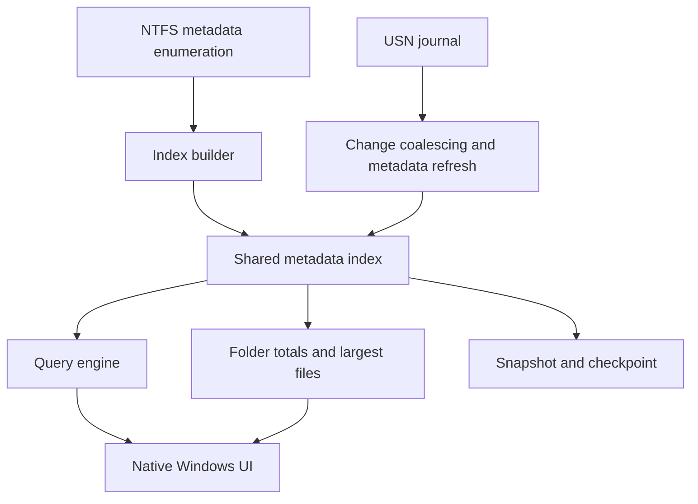

# Product and technical plan

Updated 17 November 2026. Version **0.0.1** is a working Windows CLI prototype. This document describes the intended product, not a claim that all planned features exist. See [current CLI coverage](CLI.md) and [measured results](MEMORY_RESULTS.md).

## Product scope

Build a Windows desktop application that finds files and explains disk usage from the same current metadata index. Priorities: correctness, low resource consumption, perceived speed, and a simple interface.

The selected first-release scope is file/folder search and a disk-space map. Content indexing comes later. The product and project documentation are in English.

Finding everything means supported, indexed file/folder metadata. It does not include deleted-file recovery, locked BitLocker volumes, archive contents, offline cloud contents, or arbitrary virtual filesystems. VHDX/WSL/archive containers initially appear as outer files. Target Windows 11 x64 and local NTFS SSD/HDD first; Windows 10, ARM64, ReFS, FAT/exFAT, NAS, and network shares require separate compatibility work.

## User experience

Search should open from a shortcut, accept cancellable queries, and expose name/path/extension/type/volume/size/date filters. Results need virtualization, keyboard access, high-DPI support, and normal-user Shell actions for open/reveal/copy-path. Full count and final sorting may finish after first visible results; partial status must be explicit.

Planned query syntax, not current CLI syntax:

```text
invoice
ext:pdf
size:>1GiB
path:"D:\Projects" ext:rs
type:folder
modified:>=2026-11-01
```

The parser must define quoting, AND, OR, and exclusion. Invalid queries must not silently change meaning. Unicode case behavior requires explicit tests; lossy display text must not identify file objects.

Disk analysis should link volume/folder navigation, a tree, file list, and treemap. Show totals, child counts, percentages, largest files/folders, and extension breakdowns. Make logical versus allocated space explicit. Display unknown/inaccessible coverage and freshness. Opening the map should reuse metadata rather than trigger another complete scan; missing sizes can finish in the background with visible partial status.

Content/OCR/semantic search, duplicate detection, continuous hashing, automatic cleanup, remote search, and Explorer replacement are outside the first-release scope. Initial disk analysis is read-only; destructive file operations are a separate decision.

## Architecture

| Area | Direction |
| --- | --- |
| Core | Rust with a pinned stable MSVC toolchain and compact data structures |
| Windows APIs | Narrow `windows-sys` FFI boundary with required features only |
| UI candidate | Win32 virtual ListView and Direct2D map; validate accessibility and memory before committing |
| Index | Versioned snapshot, shared name/key pools, bounded committed delta layer |
| Updates | NTFS USN journal plus targeted metadata refresh |
| Settings | Small local configuration; no general-purpose database required on the hot path |
| Persistence | Atomic snapshot publication, durable checkpoints, source validation |



A single normal-user core should own the index; avoid copies in separate UI/query processes. Stop rendering and icon/preview work while hidden. A narrow elevated helper may read volume metadata; it must not execute arbitrary client commands or perform Shell actions as administrator. Service installation, autostart, session lifecycle, and IPC permissions require explicit acceptance before deployment.

## NTFS correctness

Capture stable volume identity, journal identity, and a starting USN boundary before enumeration. Build the canonical file-reference/name/parent index with `FSCTL_ENUM_USN_DATA`, separately collect absent metadata such as size, replay concurrent changes, and verify the starting boundary still belongs to retained journal history. Native enumeration is not a raw MFT byte dump; USN V2 records do not contain file lengths.

Coalesce changes by complete file reference, including sequence bits. Refresh size on data changes, handle rename/move/delete and parent changes, and avoid double-applying updates. Only advance the durable checkpoint with its committed index state. Journal wrap/recreation, sleep/resume, device removal, and changing mounts need reconciliation. Do not assume close events alone are enough for actively written files.

Raw MFT parsing is an optional measured follow-up, with fixup, attribute-list, extension-record, and corruption handling. It is not the default first solution. Cloud content must not be downloaded simply to learn a size.

## Data and query model

The target model is `Volume -> FileObject -> DirectoryEntry`: hard links create multiple names for one object. Name search returns entries; deduplicated physical-space accounting counts objects. The present prototype stores one canonical name, so full link discovery remains future work.

Keep original UTF-16 names separate from normalized search keys. Reconstruct paths from parents on demand rather than storing every full path. Distinct-name groups support exact/prefix lookup and substring candidate masks; extension and size orderings remain optional measured costs. Return top-k without materializing millions of UI objects. New requests must cancel stale work and bind to a consistent generation. Bound overlays and measure compaction peaks.

Memory mapping is an option, not free RAM. Report private, resident, and file-cache effects independently. Any layout change must preserve full IDs, USNs, unknown/zero distinctions, names, ordering, and delta behavior.

## Disk-space semantics

| Measure | Meaning |
| --- | --- |
| Logical size | Visible default-stream data length |
| Allocated space | Verified allocation/compression accounting; not necessarily reclaimable by deleting one path |
| Folder logical total | Logical lengths of reachable name entries, with hard-link duplication disclosed |
| Deduplicated space | Count each file object once within its volume identity |
| Unknown space | Missing or unsupported metadata; never silently treated as zero |

Build folder totals bottom-up. Apply a changed file's delta to ancestors; move existing subtree totals between ancestor chains when a large folder moves. Apply concurrent operations within consistent generations.

A deterministic owner name can make treemap totals avoid counting hard-linked objects twice; mark other names. A selected folder's reachable deduplicated total is a different measure. Do not promise reclaimed space before the last hard link disappears. Sparse/compressed/resident data, ADS, placeholders, and allocated sizes need separate correctness fixtures. File totals need not equal Windows used-space totals because of system metadata, shadow copies, reserved clusters, or inaccessible objects; show unexplained differences without inventing causes.

## Resource and access controls

Use bounded work queues and backpressure, with separately measured HDD/SSD concurrency. Avoid idle full scans and periodic UI redraws. Request/cache icons only for visible rows; contain third-party Shell extension stalls. Pause or slow background completion on battery power and support volume exclusions.

Measure normal operation, mutation bursts, and old/new generation overlap during compaction. Keep metadata and IPC user-scoped. Raw volume metadata may reveal names beyond normal per-file visibility; the prototype is explicitly authorized administrative use with a private index. Do not expose a machine-wide multi-user service until name visibility rules are proven.

## Delivery stages

| Stage | Deliverable | Exit condition |
| --- | --- | --- |
| A: feasibility | Native CLI, size-probe experiment, resource reports | Real-disk and small-fixture correctness; measured bottlenecks |
| B: durable core | Parser, snapshot/journal recovery, largest files | Consistent rename/move/delete and gap/recovery cases |
| C: disk analysis | Incremental totals, hard-link policy, map data | Independent size agreement and visible partial coverage |
| D: desktop alpha | Native UI, shortcut, tray, virtual results, treemap | Keyboard/DPI checks and UI-inclusive resource/latency budgets |
| E: beta/distribution | Installer/update/helper lifecycle | Windows acceptance and versioned competitor comparisons |
| F: expansion | Other filesystems, NAS, optional content search | Separate coverage and resource budget for each mode |

The CLI has implemented parts of A and B. GUI, parser, full size coverage, allocated-space accuracy, and disk analysis remain unfinished. Content search should use a separate opt-in index for selected folders/types; OCR/semantic search must not become a mandatory metadata cost. Estimate delivery dates after size-collection and UI feasibility are measured.

The competitive hypothesis is faster transitions between search and disk analysis with compact metadata, selective helpers, and clear freshness. A 2x p95 improvement in comparable large-index query classes is an engineering aim, not a guarantee. Do not omit slower query classes or ignore CPU/RAM/I/O tradeoffs. See the [benchmark protocol](BENCHMARKS.md).

References consulted for the plan: [Everything indexes](https://www.voidtools.com/support/everything/indexes/), [NTFS enumeration](https://learn.microsoft.com/en-us/windows/win32/api/winioctl/ni-winioctl-fsctl_enum_usn_data), [USN V2](https://learn.microsoft.com/en-us/windows/win32/api/winioctl/ns-winioctl-usn_record_v2), [journals](https://learn.microsoft.com/en-us/windows/win32/fileio/change-journals), [hard links](https://learn.microsoft.com/en-us/windows/win32/fileio/hard-links-and-junctions), [sparse sizes](https://learn.microsoft.com/en-us/windows/win32/fileio/obtaining-the-size-of-a-sparse-file).
